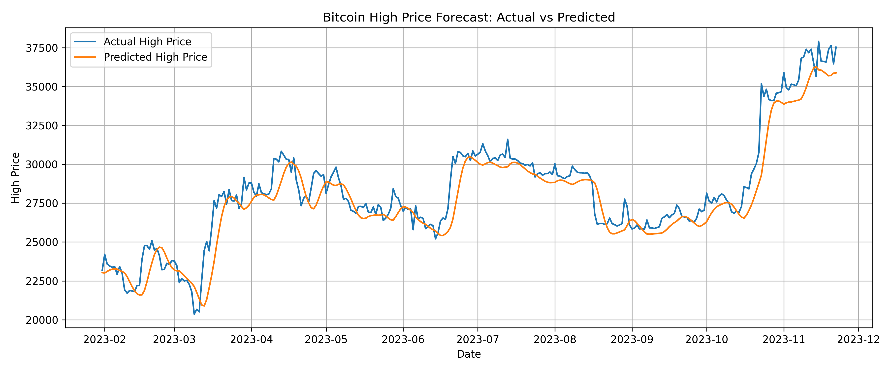
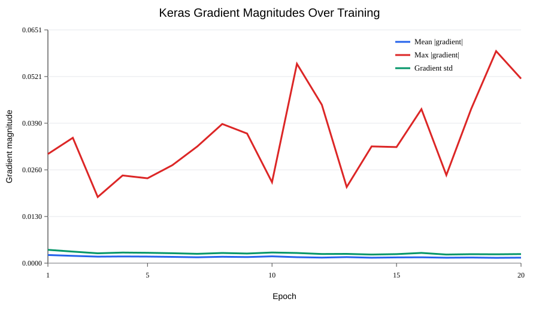

# Customer Churn Classification & Bitcoin LSTM Forecasting

Two applied machine learning workflows: comparing classifiers on customer churn data and evaluating an LSTM on historical Bitcoin high prices against a simple persistence baseline.

**Portfolio contributor:** Yuwen "Richard" Shan  
**Context:** USC DSCI 352, Spring 2026 — a two-person team project. Both team members jointly completed all development; the other contributor is not named in this public presentation. The teammate has agreed to publication. Telco code was developed from a course-provided starter script.

## Results at a glance

- **Customer churn:** Gradient Boosting achieved validation ROC AUC **0.8455** and accuracy **0.8055** on the fixed stratified 80/20 split.
- **Bitcoin:** The release LSTM achieved test RMSE **1199.93** and MAE **853.94** across **296** rolling predictions. The previous-observation baseline performed better: RMSE **668.32**, MAE **440.36**.
- This project demonstrates preprocessing, model comparison, neural-network diagnostics, time-series evaluation, and saved-model inference. The BTC results do not establish an advantage over persistence.



## Quick start

Verified on macOS with Python **3.12.3**. The pinned dependencies describe the environment used for the release verification; Windows, Linux, and a fresh dependency installation were not separately tested.

```bash
python3 -m venv .venv
source .venv/bin/activate
python -m pip install -r requirements.txt
```

On Windows, activate with `.venv\Scripts\activate` instead. Run these commands from the repository root:

```bash
# Train and compare Telco models (20 neural-network epochs)
python scripts/train_telco.py

# Train the BTC LSTM (up to 50 epochs; early stopping enabled)
python scripts/train_btc.py

# Run historical rolling predictions with the included BTC model and scaler
python scripts/predict_btc.py --input data/btc_price.csv --output results/btc/btc_cli_predictions.csv

# Run the regression checks
python -m unittest discover -s tests -v
```

The saved BTC model and scaler are included, so the prediction command can run without training first. Training writes new results and replaces the corresponding release artifacts. `results/reference/` retains the original course-run records.

Default file locations are resolved relative to the scripts, so these scripts also work when invoked by their full path from another directory. Explicit relative paths supplied through arguments are relative to the caller's current directory.

## Project structure

```text
churn-and-bitcoin-ml/
├── README.md
├── requirements.txt
├── requirements-aws.txt
├── data/
│   ├── README.md
│   ├── telco_churn.csv
│   └── btc_price.csv
├── scripts/
│   ├── train_telco.py
│   ├── train_btc.py
│   └── predict_btc.py
├── models/
│   ├── btc_lstm_model.keras
│   └── btc_scaler.pkl
├── results/
│   ├── telco/       # Release-run comparisons and gradient diagnostics
│   ├── btc/         # Release-run predictions, comparisons, plots, and metadata
│   └── reference/   # Original course-run metrics and predictions
├── tests/
└── docs/
```

## 1. Customer churn classification

The dataset contains **7,043** customer records. `customerID` is excluded from model inputs; `Churn` is mapped to a binary target. Numeric features use median imputation and standardization. Categorical features use mode imputation and one-hot encoding, including handling for previously unseen categories.

Each preprocessing pipeline is fitted on training rows only. All five models share an 80/20 stratified split with `random_state=42`. The classifiers are Logistic Regression, Random Forest, Gradient Boosting, SGD with logistic loss, and a dense Keras network with 64/32/16 hidden units and dropout.

| Model | Validation ROC AUC | Validation accuracy |
|---|---:|---:|
| gradient_boosting | 0.8455 | 0.8055 |
| logistic_regression | 0.8413 | 0.7381 |
| random_forest | 0.8375 | 0.7743 |
| sgd_log_loss | 0.8358 | 0.7757 |
| keras_mlp | 0.8331 | 0.7878 |

Accuracy uses a 0.5 probability threshold. The original selection policy favors Keras only if its AUC is within 0.01 of the best traditional model and its gradient heuristic is stable; Gradient Boosting was selected in the verified release run.



The gradient tracker uses one fixed training batch and heuristic magnitude thresholds. These diagnostics are illustrative and do not prove convergence or identify every training issue. Metrics come from one validation split, with no separate final test set or cross-validation. The script compares models and exports diagnostics; it does not save a Telco inference model in the default local workflow.

## 2. Bitcoin high-price forecasting

The provided CSV contains **1650** observations covering **2019-03-08 through 2023-11-22**. Only `Date` and `High` are used. The configured test filter extends through 2025, but the supplied data ends in 2023; no 2024–2025 observations are evaluated.

- Training observations: **2019-03-08–2022-12-31**.
- Test input observations: **2023-01-01–2023-11-22**.
- Evaluated targets: **2023-01-31–2023-11-22**, **296** observations.
- Model: 64-unit LSTM → dropout 0.2 → 32-unit LSTM → dropout 0.2 → Dense(1); Adam and MSE.
- Scaling: MinMaxScaler fitted on the training period only.
- Windows: the previous **30 observations** predict the next available observation. There are **7 non-daily intervals** in the supplied series; missing days are not filled.
- Training: batch size 32, at most 50 epochs, a final 20% training-window validation segment, and early stopping with patience 10 and best-weight restoration. The release run used seed 42 and completed 50 epochs. Architecture and hyperparameters were not tuned for this release.

| Model | Test RMSE | Test MAE |
|---|---:|---:|
| LSTM, release run | 1199.93 | 853.94 |
| Previous observed High, same targets | 668.32 | 440.36 |

Errors are in the numeric price units of the provided `High` field; the CSV does not record currency metadata. The original saved model had RMSE **1262.30** and MAE **859.31** on the same test targets. Those records are preserved separately. Neural-network results can differ between runs, dependency versions, and hardware.

### Evaluation limits

This is a **rolling one-step historical evaluation**. Each test prediction uses the previous observed actual prices, including earlier test observations. It is not a multi-step forecast issued at the beginning of 2023. The first 30 test observations provide context and are not scored; windows do not carry training-period context into the test period.

Adjacent windows overlap. The original train-window validation arrangement is retained, and the scaler uses the full training period rather than only the fit subsection. Consequently, the internal validation score is not a fully isolated temporal benchmark. The later test period remains outside scaler fitting and model training.

The persistence baseline beats the LSTM on both reported test metrics. Results support discussion of smoothing, lag, and model evaluation; they do not demonstrate profitable trading or superior forecasting. Additional rolling-origin validation and baseline comparisons would be reasonable future extensions, but were not added here.

### Prediction CLI

The input must include `Date` and `High` and contain at least **31 valid observations**. Invalid Date/High rows are dropped and reported; duplicate dates and non-finite prices are rejected. The CLI sorts observations before creating windows.

```bash
python scripts/predict_btc.py --input data/btc_price.csv --output results/btc/btc_cli_predictions.csv --model models/btc_lstm_model.keras --scaler models/btc_scaler.pkl
```

Output columns are `Date`, `Actual_High`, `Predicted_High`, and `Absolute_Error`. The demonstration command includes training-period observations, so its full-file error is not a holdout score. Use `results/btc/test_predictions.csv` and `model_comparison_btc.csv` for the reported test evaluation. The CLI predicts dates already present in the supplied CSV; it does not append a future date or provide a live forecast service.

## Optional AWS export

The inherited Telco utility can refit an SGD pipeline on all supplied rows, export compatible preprocessing parameters and coefficients, and upload the JSON to a configured S3 bucket. It is optional and is not a deployed API or Lambda service.

```bash
python -m pip install -r requirements-aws.txt
python scripts/train_telco.py --aws-export --bucket YOUR_S3_BUCKET
```

`YOUR_S3_BUCKET` is your own bucket name. Credentials use the normal AWS configuration outside this repository. `MODEL_BUCKET`, `MODEL_KEY`, and `AWS_REGION` are supported. No cloud upload was performed or verified during release preparation.

## Attribution and project notes

- **Yuwen "Richard" Shan** and one teammate jointly completed all project development. The release preserves that team attribution and does not claim sole authorship.
- The Telco implementation extends a course-provided starter script; Bitcoin training and the CLI were implemented for the course project.
- Telco source: the course materials cite [Telco Customer Churn on Kaggle](https://www.kaggle.com/datasets/blastchar/telco-customer-churn). Bitcoin data was supplied by the professor; its original upstream provider was not recorded. See [data provenance](data/README.md).
- AI tools supported drafting, debugging, explanation, and release preparation. Code, saved outputs, and reported release metrics were checked through local execution.
- No blanket open-source license has been assigned to the combined course-derived code and provided datasets. Dataset attribution does not itself establish redistribution terms.

See [release changes](docs/RELEASE_CHANGES.md), [verification evidence](docs/VERIFICATION.md), and [manual upload guide in Chinese](docs/UPLOAD_GUIDE_zh.md).
